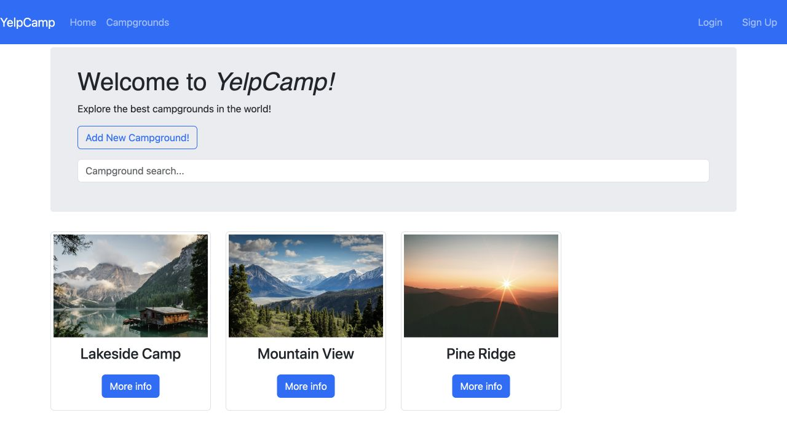

# YelpCamp

A campground discovery and community application built with Node.js, Express,
MongoDB and EJS. Visitors can browse and search campgrounds. Registered users can
publish listings, discuss them in comments, and manage their own contributions.



## Academic context

Originally developed as an **Internet Technologies project at FON**.
The application combines server rendered pages, a MongoDB database, account
authentication and web application development fundamentals.

## Features

- Account registration, login and logout with hashed passwords
- Campground creation, editing and deletion with author ownership checks
- Comments with author ownership and campground relationship checks
- Search by campground name with safe rendering and a short typing delay
- Admin moderation for accounts provisioned directly by the operator
- Responsive server rendered pages and session messages
- JSON endpoints using the same authentication and ownership rules as the website

The application retains its original landing slideshow, campground grid and
Bootstrap page structure. It does not include bookings, payments or verified
campground locations.

## Run locally

Use Node.js **22.12 or newer within version 22**, or **Node.js 24**, and MongoDB 8.

```sh
git clone https://github.com/stefisha/YelpCamp.git
cd YelpCamp
npm ci
cp .env.example .env
```

Generate a session secret and put the result in `SESSION_SECRET` in `.env`:

```sh
node -e "console.log(require('node:crypto').randomBytes(48).toString('hex'))"
```

Start your local MongoDB, or use the included Compose service:

```sh
docker compose up -d
npm start
```

Open [localhost:3000](http://localhost:3000). Register an account and add your first
campground. Images are supplied as HTTPS URLs. `npm run dev` restarts the server
when application files change.

On Windows, copy `.env.example` to `.env` using your terminal or file manager.
Docker is optional if MongoDB is already installed or you use a managed database.

## Configuration

| Variable         | Purpose                                                                   |
| ---------------- | ------------------------------------------------------------------------- |
| `DATABASEURL`    | MongoDB connection string. Defaults to the local database in development. |
| `SESSION_SECRET` | Random secret of at least 32 characters. Required in production.          |
| `PORT`           | Listening port. Defaults to `3000`.                                       |
| `NODE_ENV`       | Set to `production` for HTTPS session cookies and production headers.     |
| `TRUST_PROXY`    | Set to `1` only behind exactly one trusted reverse proxy.                 |

Sessions persist in MongoDB and expire after one day. Development without a
configured secret generates a temporary one, so sessions will not survive a restart.
New registrations require a password of 12 to 128 characters. Existing accounts
can continue signing in with their existing passwords.

Public signup always creates a regular user. There is no public admin signup
code. An operator can grant `isAdmin` to a specific account in the database.

## API

| Method   | Route                                  | Access                        |
| -------- | -------------------------------------- | ----------------------------- |
| `GET`    | `/api`                                 | Public, latest 100 listings   |
| `POST`   | `/api`                                 | Signed in user                |
| `PUT`    | `/api/:id`                             | Listing author or admin       |
| `DELETE` | `/api/:id`                             | Listing author or admin       |
| `GET`    | `/campgrounds/searching?search=forest` | Public, up to 100 matches     |
| `GET`    | `/health`                              | Public process liveness check |

Writes use the login session and a CSRF token. Obtain a token from a form in the
same session, then send it as `X-CSRF-Token` or `_csrf`. JSON listing bodies accept
`name`, `price`, `image` and `description`. Authors and role flags cannot be
assigned through these endpoints. Authentication errors return `401`, ownership
or token failures `403`, invalid data `400`, and missing records `404`.

The API is session based. It does not provide independent API keys or bearer tokens.

## Verification

```sh
npm test
npm run check
npm audit
```

Tests use a disposable MongoDB instance and do not connect to `DATABASEURL`.
The first test run downloads a MongoDB binary. Integration coverage includes
registration and login, CSRF, ownership on web and API routes, admin moderation,
input validation, comment relationships, deletion cleanup and error responses.
A DOM regression test checks that search results display markup as literal text.
GitHub Actions runs these checks on Node.js 22 and 24.

## Deployment

Use HTTPS, a private or authenticated MongoDB connection, a stable random session
secret and the supported Node runtime. Configure proxy trust for your actual
network. The server connects to MongoDB before accepting requests and closes
connections on shutdown.

The old API accepted mutations without authentication. Clients must now sign in
and send valid form tokens. Logout uses `POST /logout`. Database collection names
and the existing author references remain compatible with the original app.
Back up an existing database before upgrading its MongoDB server.

The application has been run locally for verification. The README screenshot
shows a local test instance with demonstration listings. This is not a public
deployment. The previously listed hosted demo has not been verified.

## Structure

```text
app.js                Express setup and middleware
server.js             Database, session store and server lifecycle
routes/               Authentication, listings, comments and JSON endpoints
models/               Mongoose models and account plugin
middleware/           Authentication, ownership and parent relationship checks
lib/                  Validation and session messages
views/                EJS pages
public/               Styles and browser scripts
test/                 Integration and DOM regression tests
```

**Maintainer:** [Stefan Veličković](https://github.com/stefisha)

[Project contributors](https://github.com/stefisha/YelpCamp/graphs/contributors)
